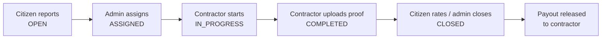
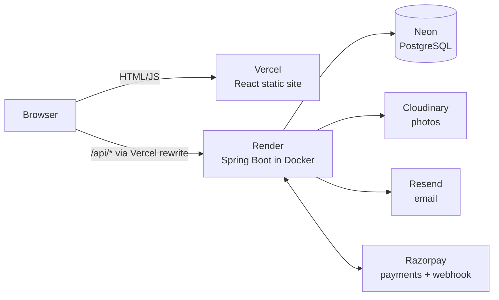

# Relay

**Work orders, SLA tracking and payment orchestration for public-infrastructure issues.**
Citizens report a problem (pothole, garbage, water leak…), an admin hands it to a contractor, the contractor fixes it, and Relay watches the clock, flags late work and settles the money. The idea is a *relay race*: every fix is a hand-off, and Relay keeps the baton moving.

- [How it works](#how-it-works)
- [Architecture](#architecture)
- [Tech stack](#tech-stack)
- [Repo layout](#repo-layout)
- [Run it locally](#run-it-locally)
- [Configuration (environment variables)](#configuration-environment-variables)
- [Backend deep dive](#backend-deep-dive)
- [Frontend deep dive](#frontend-deep-dive)
- [Infra files explained](#infra-files-explained-dockerfile-compose-nginx-vercel-ci)
- [Deploying](#deploying)
- [Accounts and security](#accounts-and-security)
- [Known gaps / roadmap](#known-gaps--roadmap)

---

## How it works

### Roles

| Role | Can do |
|---|---|
| **Citizen** | Report issues (photo + GPS), track them, pay the optional fast-track fee, rate finished work |
| **Contractor** | See assigned work orders, start work, mark complete with a proof photo. Must be **approved by an admin** first |
| **Admin** | Assign work, close completed orders, issue fines, release contractor payments, edit SLA policies, manage people, see analytics |

### Life of a work order



Every step is written to an audit trail (`WorkOrderEvent`) shown as the timeline on the order page, and the people involved get in-app notifications.

### SLA (Service Level Agreement)
- Each category (pothole, garbage, water leak, streetlight, drainage, other) has an **SLA policy**: hours to resolve, breach fine, contractor payout rate and fast-track fee. Admins edit these on the *SLA policies* page; changes apply to new reports.
- When a work order is created its `slaDeadline` is set from the policy. The UI shows a live countdown.
- **Fast-track:** a citizen can pay a fee to halve the remaining SLA.
- **Scheduler:** `SlaScheduler` runs every 60 seconds and flags active orders past their deadline as breached, logs it on the timeline and notifies admins, the contractor and the citizen. An order still unassigned (`OPEN`) is also escalated to high priority. This is why the backend needs an **always-on** host.

### Payments (Razorpay)
Three payment types live in one ledger (`Payment`): `FAST_TRACK` (citizen pays), `FINE` (SLA penalty on a contractor, issued by an admin) and `CONTRACTOR_PAYOUT` (admin releases after the job closes).
- Checkout: backend creates a Razorpay order, the frontend opens Razorpay checkout, the backend verifies the **HMAC-SHA256 signature** and marks it paid. A **webhook** (`POST /api/payments/webhook`, signature-verified, idempotent) is the safety net if the browser closes mid-payment.
- **Mock mode:** with no `RAZORPAY_KEY_ID` the same flow runs with a stand-in checkout sheet. No real money, no Razorpay account needed.
- Contractor payouts are **simulated** (recorded, not transferred). Real payouts need RazorpayX.

### "AI" features (honest version: rule-based)
- **Relay Assist** (`ClassifierService`): keyword classifier suggests category and severity while the citizen types; also tags feedback sentiment.
- **Delay risk** (`PredictionService`): a transparent 0-99 score from SLA time elapsed, assignment state, contractor workload and the category's history. Shown on order cards and in the admin "at risk" list.

### Admin analytics
KPIs, 7-day trend, hotspot map by area, at-risk orders, contractor scoreboard and money moved (`AnalyticsService`).

---

## Architecture

**Production** (what is deployed):



The browser only ever talks to the Vercel domain. `frontend/vercel.json` **rewrites** `/api/*` to the Render backend, so there is no CORS to configure and the backend URL stays out of the frontend code.

**Local dev:** Vite dev server (:5180) proxies `/api` to Spring Boot (:8080), which uses an embedded H2 database. No Docker or Postgres needed.

**Local Docker:** `docker compose` runs Postgres + backend + an nginx container serving the built frontend (:8081).

---

## Tech stack

| Layer | Technology | Why / notes |
|---|---|---|
| Frontend | **React 18 + Vite** | Fast dev server and build |
| Styling | **Tailwind CSS** | Custom "Relay" theme: ink `#14172B`, baton orange `#FF5B2E`, paper `#FAF6EF`; fonts Bricolage Grotesque + DM Sans |
| HTTP | **Axios** | One instance in `src/api.js` adds the JWT and handles 401s |
| Routing | **React Router** | Protected routes + admin-only routes |
| Backend | **Spring Boot 3.5, Java 25** | REST API, one deployable (monolith) |
| Security | **Spring Security + JWT (jjwt)** | Stateless auth, `@PreAuthorize` role checks, BCrypt passwords |
| Data access | **Spring Data JPA / Hibernate** | `ddl-auto: update` creates/updates tables on boot (no migration tool yet) |
| Database | **PostgreSQL** (prod) / **H2** (local dev) | Selected by Spring profile (`postgres` vs `dev`) |
| Boilerplate | **Lombok** | Getters/setters on entities |
| Payments | **Razorpay** via REST + webhook | Plain `RestClient`, no SDK |
| Photos | **Cloudinary** (prod) / local disk (dev) | Signed uploads via REST |
| Email | **Resend** HTTP API | Reset + verification mails; logs to console if no key |
| Scheduler | Spring `@Scheduled` | SLA sweep every 60 s |
| Packaging | **Docker**, docker-compose, nginx | See [Infra files](#infra-files-explained-dockerfile-compose-nginx-vercel-ci) |
| CI | **GitHub Actions** | Builds backend + frontend on every push/PR |
| Hosting | **Vercel** (frontend), **Render** (backend), **Neon** (Postgres) | See [Deploying](#deploying) |

---

## Repo layout

```
Relay/
├── backend/                       Spring Boot API
│   ├── pom.xml                    Maven dependencies + Java version
│   ├── mvnw, mvnw.cmd             Maven wrapper (no global Maven install needed)
│   ├── Dockerfile                 Builds the backend image
│   └── src/main/
│       ├── resources/application.yml      All config + Spring profiles (dev / postgres)
│       └── java/com/relay/
│           ├── RelayApplication.java      Entry point
│           ├── config/    Security, JWT filter, rate limiter, CORS, DataSeeder
│           ├── domain/    JPA entities + enums (the data model)
│           ├── repo/      Spring Data repositories (DB queries)
│           ├── service/   Business logic (work orders, payments, SLA, auth, mail…)
│           └── web/       REST controllers, DTOs, error handling
├── frontend/                      React app
│   ├── Dockerfile, nginx.conf     Container build + web server (used by docker-compose)
│   ├── vercel.json                Vercel rewrites to the backend + SPA fallback
│   ├── vite.config.js             Dev server (:5180) + /api proxy
│   └── src/
│       ├── main.jsx, App.jsx      Bootstrap + routes
│       ├── api.js, auth.jsx       Axios instance, auth context
│       ├── pages/                 One file per screen
│       └── components/            Shared UI (Layout, PayModal, RelayTrack, PasswordInput…)
├── docker-compose.yml             Local Postgres + backend + frontend
└── .github/workflows/ci.yml       CI pipeline
```

---

## Run it locally

### Option A: no Docker, no Postgres (fastest)

Requires **Java 25** and **Node 20+**.

```bash
# terminal 1: API on :8080 (embedded H2 file DB, seeds an admin + demo data)
cd backend && ./mvnw spring-boot:run          # Windows: mvnw.cmd spring-boot:run

# terminal 2: UI on :5180 (proxies /api to :8080)
cd frontend && npm install && npm run dev
```

Open http://localhost:5180. Local-only defaults (dev profile): admin `admin@relay.app` / `admin123`; demo contractors and citizens share the password `demo12345` (admins see them under **People**). To reset local data, stop the backend and delete `backend/data/`.

Emails (verification, password reset) are **printed in the backend console** when no `RESEND_API_KEY` is set, so grab links from there.

### Option B: Docker (Postgres + nginx, closer to production)

```bash
docker compose up --build        # UI at http://localhost:8081
```

Default admin is `admin@relay.app` / `admin12345` (override with a `.env` file next to `docker-compose.yml`). Data persists in Docker volumes; `docker compose down -v` wipes it.

---

## Configuration (environment variables)

All config is in `backend/src/main/resources/application.yml` and read from environment variables. Anything marked **prod** must be set on the Render service.

| Variable | Purpose | Default / notes |
|---|---|---|
| `SPRING_PROFILES_ACTIVE` | `dev` (H2) or `postgres` | **prod:** `postgres` |
| `DB_URL` `DB_USER` `DB_PASSWORD` | Postgres connection | **prod.** `DB_URL` must be JDBC style: `jdbc:postgresql://host/db?sslmode=require` (user/password separate) |
| `JWT_SECRET` | Signs login tokens | **prod:** 40+ random chars. Never commit it |
| `ADMIN_EMAIL` `ADMIN_PASSWORD` | Creates the first admin at startup (only if no account has that email; 8+ char password) | **prod** |
| `SEED_DEMO_DATA` | Seed demo contractors/citizens/orders | `true`; **prod:** `false` unless you want demo data |
| `DEMO_PASSWORD` | Shared password for seeded demo accounts | Required when seeding outside dev |
| `CLOUDINARY_CLOUD_NAME` `CLOUDINARY_API_KEY` `CLOUDINARY_API_SECRET` | Photo storage. All blank = save to local disk | **prod** (Render disks are wiped on redeploy) |
| `RAZORPAY_KEY_ID` `RAZORPAY_KEY_SECRET` `RAZORPAY_WEBHOOK_SECRET` | Payments. Blank key id = mock mode | **prod** for real payments |
| `RESEND_API_KEY` `MAIL_FROM` | Email sending. No key = emails logged to console | `MAIL_FROM` must be on a domain verified in Resend |
| `APP_URL` | Public frontend URL, used in email links (no trailing slash) | **prod** |
| `REQUIRE_EMAIL_VERIFICATION` | Require verified email to report/receive work | `true` (dev: `false`). Set `false` until email is set up |
| `RATE_LIMIT_ENABLED` | Per-IP request limits | `true` |
| `CORS_ORIGINS` | Allowed browser origins | Not needed with the Vercel rewrite |
| `PORT` | HTTP port | `8080`; Render sets it for you |
| `UPLOAD_DIR` | Local photo folder when Cloudinary is off | `./uploads` |
| `JAVA_TOOL_OPTIONS` | JVM flags | e.g. `-XX:MaxRAMPercentage=70` on 512 MB hosts |

---

## Backend deep dive

**Request path:** `RateLimitFilter` → `JwtAuthFilter` (loads the user from the token) → Spring Security rules + `@PreAuthorize` → Controller → Service → Repository → DB. Errors are thrown as `ApiException` and turned into `{ "message": "..." }` JSON by `ApiExceptionHandler`.

**Layers:** Controllers (`web/`) stay thin; all rules live in services (`service/`); entities in `domain/`; DTO records in `Dtos.java` keep entities out of the API.

### Data model

| Entity | What it holds |
|---|---|
| `User` | name, email, password hash, role, `approved` (contractors), `suspended`, `emailVerified`, `demo`, `passwordChangedAt` |
| `WorkOrder` | code (`RLY-000042`), title, description, category, severity, status, location, photo, citizen, contractor, SLA deadline and flags (breached / escalated / fast-track), rating + feedback + sentiment, payment flags |
| `WorkOrderEvent` | audit-trail entries (who did what, when, optional photo) |
| `SlaPolicy` | per-category hours, fine, contractor rate, fast-track fee |
| `Payment` | type (`FAST_TRACK` / `FINE` / `CONTRACTOR_PAYOUT`), status, amount, payer/payee, Razorpay ids, invoice number |
| `Notification` | in-app notification per user |
| `PasswordResetToken`, `EmailVerificationToken` | one-time tokens (only the SHA-256 hash is stored) |

Status flow: `OPEN → ASSIGNED → IN_PROGRESS → COMPLETED → CLOSED`.

### API overview (all under `/api`)

| Area | Endpoints |
|---|---|
| Auth (public) | `POST /auth/register`, `/auth/login`, `/auth/forgot-password`, `/auth/reset-password`, `/auth/verify-email` |
| Auth (signed in) | `GET /auth/me`, `POST /auth/resend-verification` |
| Work orders | `GET /work-orders`, `GET /work-orders/{id}`, `POST /work-orders` (citizen, multipart), `POST /work-orders/classify`, `POST /{id}/assign` (admin), `POST /{id}/status` (contractor/admin, multipart), `POST /{id}/rate` and `/fast-track` (citizen), `POST /{id}/fine` and `/release-payment` (admin) |
| Payments | `GET /payments`, `GET /payments/config`, `POST /payments/{id}/checkout`, `/verify`, `/{id}/mock-pay`, `GET /payments/{id}/invoice`, `POST /payments/webhook` (public, signature-checked) |
| Admin | `GET /analytics`, `GET /contractors`, `PUT /sla-policies/{id}`, `GET /admin/users`, `PUT /admin/users/{id}`, `GET /admin/demo-accounts` |
| Other | `GET /sla-policies`, `GET /notifications`, `POST /notifications/read-all`, `GET /health` |

### Security notes
- Passwords: BCrypt, 8+ characters. JWTs are stateless (24 h); tokens issued before a password reset, and tokens of suspended users, are rejected.
- Admin accounts are never self-service (see below). Contractors need approval; unverified emails can't report issues or receive work.
- **Rate limiting** (`RateLimitFilter`, per IP): sign-in 20/min, sign-up 10/hour, forgot-password 5 per 15 min, other auth endpoints similar, everything else 600/min. Razorpay webhook and `/api/health` are exempt. Plus a **sign-in lockout**: 5 wrong passwords for an email locks it for 15 minutes. Counters are in memory (per instance, reset on restart); use Redis before running more than one instance.
- Webhook and checkout signatures are verified with HMAC-SHA256.

---

## Frontend deep dive

| File | Role |
|---|---|
| `main.jsx`, `App.jsx` | Providers (auth, toasts) and routes. `Protected` requires sign-in, `AdminOnly` requires the admin role |
| `api.js` | Axios instance (`baseURL: /api`), attaches the JWT, redirects to login on 401, `errorMessage()` helper |
| `auth.jsx` | Auth context: `login`, `register`, `logout`, `refresh`; token kept in `localStorage` |
| `pages/` | `Login`, `ForgotPassword`, `ResetPassword`, `VerifyEmail` (public); `Dashboard`, `Orders`, `OrderDetail`, `Report`, `Payments`, `Sla`, `People` (signed in; `People` admin only) |
| `components/` | `Layout` (sidebar, notification bell, banners), `OrderCard`, `RelayTrack` (the baton progress stepper), `PayModal` (Razorpay / mock checkout), `PasswordInput` (show/hide), `Toast`, `Bits` (badges, timers, modal, spinner), `Logo` |
| `utils.jsx` | Labels, colours and formatting helpers |

The dashboard changes by role: citizens see their reports, contractors their jobs, admins the analytics.

---

## Infra files explained (Dockerfile, compose, nginx, Vercel, CI)

| File | What it is for |
|---|---|
| **`backend/Dockerfile`** | Recipe to package the API into a container image. *Stage 1* uses a Maven+JDK image to compile and build the `.jar`; *stage 2* copies only that jar into a slim JRE image. The final image is small and runs anywhere (`java -jar app.jar`). **Render builds this file** to deploy the backend. |
| **`frontend/Dockerfile`** | Same two-stage idea: Node builds the React app into static files, then nginx serves them. Used by `docker-compose` locally. **Not used on Vercel**, which builds the frontend itself. |
| **`frontend/nginx.conf`** | Config for that nginx container: serves the built site, forwards `/api/` and `/uploads/` to the `backend` container, and falls back to `index.html` so React Router URLs work on refresh. |
| **`docker-compose.yml`** | Starts the whole stack with one command: `db` (Postgres 16), `backend` and `frontend`, with env vars, a persistent volume for the database, and one for uploads. It is the "production-like on my laptop" option. Not used in deployment. |
| **`frontend/vercel.json`** | Vercel's version of nginx.conf: rewrites `/api/*` and `/uploads/*` to the Render backend URL (so the browser sees one origin and CORS is a non-issue) and the SPA fallback. **If the backend URL changes, edit this file.** |
| **`.github/workflows/ci.yml`** | GitHub Actions: on every push/PR it builds the backend (`mvn verify`, Java 25) and the frontend (`npm ci && npm run build`) so broken code is caught before merging. There are no automated tests yet, so it is only a "does it compile" check today. |
| **`backend/pom.xml`** | Maven project file: Java version, Spring Boot version and all backend dependencies. |
| **`backend/mvnw`, `mvnw.cmd`** | Maven wrapper scripts so nobody needs Maven installed; they download the right version. |
| **`backend/src/main/resources/application.yml`** | Every backend setting in one place. Values come from environment variables with safe local defaults. Profiles `dev` (H2) and `postgres` switch the database. |
| **`frontend/package.json` + `package-lock.json`** | Frontend dependencies and scripts (`dev`, `build`). The lockfile pins exact versions: commit it. |
| **`frontend/tailwind.config.js`, `postcss.config.js`, `vite.config.js`** | Styling theme/build tooling, and the Vite dev server + proxy settings. |
| **`.gitignore`** | Keeps build output, `node_modules`, local DB (`backend/data`), uploads, logs and `.env` out of git. |

**Rule of thumb:** *Dockerfile = how to build one service. docker-compose = how to run several services together. nginx.conf / vercel.json = how requests get routed. ci.yml = automatic checks.*

---

## Deploying

Current production setup: **Vercel** (frontend) + **Render** (backend, Docker) + **Neon** (Postgres) + **Cloudinary** (photos) + **Resend** (email) + **Razorpay** (payments).

1. **Neon:** create a project; turn its connection string into `DB_URL` / `DB_USER` / `DB_PASSWORD` (JDBC format, see [config](#configuration-environment-variables)).
2. **Render:** *New → Web Service* from the GitHub repo. Root directory `backend`, runtime **Docker**, health check path `/api/health`, then add the environment variables above. Use an **always-on** instance (the free tier sleeps and stops the SLA scheduler).
3. **Vercel:** root directory `frontend`, framework Vite. Make sure `frontend/vercel.json` points at your Render URL (host only in the destination, no trailing slash).
4. **Razorpay:** add a webhook to `https://<render-host>/api/payments/webhook` with the same secret as `RAZORPAY_WEBHOOK_SECRET`; events `payment.captured` and `payment.failed`.
5. **Resend:** needs a **domain you own** (DNS records) to email real users. Until then set `REQUIRE_EMAIL_VERIFICATION=false`.
6. Pushing to the main branch redeploys Render and Vercel automatically.

---

## Accounts and security

- **Citizens** sign up freely. **Contractors** sign up but stay *awaiting approval* until an admin approves them in **People**.
- **Admins are never self-service.** The first one comes from `ADMIN_EMAIL` + `ADMIN_PASSWORD`; after that, an admin uses **People → Make admin**. Admins can also suspend or restore accounts.
- **Demo accounts** (when seeded) are flagged and listed to admins only, under **People → Demo logins**. They are not shown on the login page.
- **Email verification** is emailed on sign-up (24 h link). **Password reset** links last 30 minutes, work once, and sign the user out everywhere else.

---

## Known gaps / roadmap

- **No automated tests yet.** CI only builds. Highest-value next step.
- Contractor payouts are simulated (needs RazorpayX + contractor KYC).
- No database migrations (Hibernate `ddl-auto: update`). Move to Flyway before the schema gets complicated.
- Rate-limit counters are in memory (single instance only).
- Relay Assist is rule-based, not an image/ML model. Email/SMS notifications are in-app only.
- Not built: multi-tenancy (one city per customer), subscriptions, multi-language UI, PDF/Excel export, terms and privacy pages.
- The Java 25 Docker image has not been built and tested end to end on every machine; if the Render build fails, check the Java/base-image tags first.
